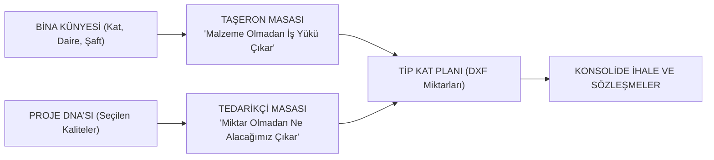
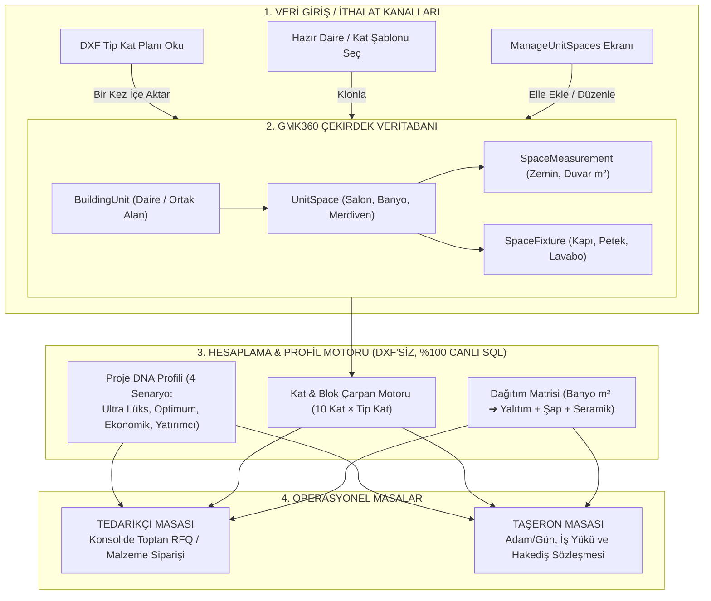

# GMK360 KAT PLANI OKUMA, TEDARİKÇİ VE TAŞERON DAĞITIM REHBERİ
**Sürüm:** 1.0 | **Tarih:** 18 Ekim 2026 | **Modül:** Metraj & Proje DNA & B2B İhale

Bu rehber; şantiyede mimari ve statik çizimlerin (DXF), satın alma (Tedarikçi Masası) ve taşeron iş gücü (Taşeron Masası) ile nasıl entegre edileceğini tanımlayan ana başvuru dokümanıdır.

---

## BÖLÜM 1: TEMEL FELSEFE VE STRATEJİ

### 1. "Makro Künyeden, Mikro DXF'ten!"
Projedeki kuleler, podyumlar, kat sayıları ve çatı tipleri gibi makro bilgileri DXF dosyasından aramak sistemi karmaşıklaştırır ve kırılgan hale getirir.
- **Makro Gerçeklik (Veritabanı / Künye):** Kaç kule/blok var, kaç katlı, kaç bodrumu var, kaç daire/dükkan var, taban oturumu kaç m² ve her bloğun çatısı ne? Bu bilgiler Adım 2 (Yapı & Blok Hiyerarşisi) modülünden doğrudan çekilir.
- **Mikro Gerçeklik (DXF / Çizim):** DXF'ten yalnızca **"1 Adet Tip Kat Planı"** taranır. Mimarın çizdiği 1 katlık plandan daire tipleri, oda alanları, doğramalar ve kat ortak alanları okunur.
- **Çarpan Motoru:** Tip katta çıkan mikro değerler, bloğun kat sayısı ve daire dağılımıyla çarpılarak projenin bütçesi tek hamlede çıkarılır.

### 2. Kutsal Üçlü: Üç Ayrı Muhatap Havuzu
Piyasada her kalemin muhatabı kesinlikle birbirinden ayrılmalıdır:
1. **Meslek Branşı (Usta / Taşeron):** İşi uygulayacak olan ehil ekip (*Elektrik Taşeronu, Sıhhi Tesisatçı, Çatı Ustası, Sıvacı, Seramikçi*).
2. **Tedarikçi Branşı (Malzeme Bayisi / Toptancı):** Faturanın kesileceği malzeme deposu (*Orman Ürünleri / Keresteci, Yalıtım Toptancısı, Demir-Çelik Toptancısı, Kiremit Bayisi*).
3. **Hizmet Yeri Branşı (Resmi Kurum / Kiralama):** Hizmetin veya resmi aboneliğin alındığı yer (*Elektrik Dağıtım Şirketi - TEDAŞ, Su İdaresi - İSKİ, Vinç Kiralama, Döküm Sahası*).

---

## BÖLÜM 2: İKİ BAĞIMSIZ MASA MANTIĞI

### A) Tedarikçi Masası ("Miktar Olmadan Ne Alınacağı Çıkar")
- DXF henüz okunmamış olsa bile DNA profili ne satın alınacağını söyler.
- **Toptan Konsolidasyon Kuralı:** Keresteciye veya izolasyoncuya parça parça gidilmez. Sistem projenin tüm ahşap kalemlerini (ihata OSB'si, kalıp plywood'u, çatı kerestesi/OSB'si, lamine/laminat parkeleri) toplar ve tek bir **Tedarikçi Teklif Cetveli (RFQ)** halinde gönderir.

### B) Taşeron Masası ("Malzeme Olmadan İş Yükü Çıkar")
- Malzemenin markası belli olmasa bile bina künyesi iş yükünü belirler (Örn: 10 dairenin tesisat borulaması, 7 kat şaft hattı, 15 banyo montajı).
- Usta bu tabloyu görünce:
  1. İş yükünü bir bakışta görür,
  2. Ekibini (usta + kalfa) ve çalışma takvimini tasarlar,
  3. Belirsizlik kalmadığı için korkusuzca en rekabetçi fiyatını verir.

---

## BÖLÜM 3: TİP KAT PLANI OKUMA VE DAĞITIM MOTORU (DISTRIBUTION ENGINE)

Sadece daireleri okumak şantiyeyi eksik bırakır. **Kat Planını bir bütün olarak okumak** hem daireleri hem de kat ortak alanlarını aradan çıkarır:

### 1. Katta Kaç Farklı Daire Tipi Var? (Benzerlik Tespiti)
Kat planındaki daireler tek tip kabul edilmez. Farklı cephe ve metrekareler ayrı tipler olarak ayrışır:
- **Tip 1 (Örn: 110 m² 3+1):** Katta 2 Adet (Salon 28 m², 3 Oda, 2 Banyo, 6 Kapı, 6 Petek).
- **Tip 2 (Örn: 75 m² 2+1):** Katta 2 Adet (Salon 22 m², 2 Oda, 1 Banyo, 4 Kapı, 4 Petek).

### 2. Kat Ortak Alanlarının Otomatik Çıkması
Aynı kat planı taranırken ortak alan geometrisi tek seferde çözülür:
- **Merdiven Evi:** Basamak adedi (18 basamak), sahanlık m², basamak & rıht mermeri mtülü.
- **Merdiven Tırabzanı / Küpeşte:** Merdiven iniş boyu (mtül).
- **Kat Holü:** Zemin graniti m², süpürgelik mtül, tavan boyası.
- **Yangın Güvenliği:** 1 Adet Yangın Kapısı, 1 Adet Yangın Dolabı.

### 3. Tek Geometriden Çoklu İmalat Türetme (Dağıtım Matrisi)
Tek bir alan okunduğunda sistem onu alt imalatlara otomatik dağıtır:
- **Banyo Zemin m² okundu:**
  - ➔ *1. Sürme Su Yalıtımı* (İzolasyoncu)
  - ➔ *2. Eğim Şapı* (Şapçı)
  - ➔ *3. Taban Seramiği* (Seramikçi + Seramik Bayisi)
  - ➔ *4. Yapıştırıcı Harç ve Derz Dolgusu* (Yapı Kimyasalları)
- **Radyatör Boyu / Isıtma Alanı okundu:**
  - ➔ DNA'da "Alüminyum döküm mü, panel mi, yerden ısıtma mı?" tercihine bakar, metrajı ve vanaları hesaplar.

---

## BÖLÜM 4: CANLI SENARYO — E BLOK TİP KAT PLANI UYGULAMASI

### E Blok Künye Verisi:
- **Yapı Türü:** Kule (Ortak Baza Üstü, Bodrumsuz)
- **Kat Sayısı:** 10 Normal Kat
- **Toplam Daire:** 30 Daire *(10 Kat × Katta 3 Daire)*
- **Çatı:** Eğimli Sac / Sandviç Panel Çatı

### 1 Adet E Blok Tip Kat Planı Okunduğunda:
- **Daire 1 (3+1 - 105 m²):** 6 Kapı, 6 Petek, 66 m² Parke, 20 m² Seramik.
- **Daire 2 (2+1 - 72 m²):** 4 Kapı, 4 Petek, 46 m² Parke, 14 m² Seramik.
- **Daire 3 (2+1 - 72 m²):** 4 Kapı, 4 Petek, 46 m² Parke, 14 m² Seramik.
- **Ortak Alan (1 Kat):** 18 Basamak Merdiven Mermeri, 9 mt Tırabzan, 25 m² Hol Graniti, 1 Yangın Kapısı.

### 10 Kat Çarpanı ile E Bloğun Çıkardığı Kesin Bütçe:
- **Daireler:** `10 × Daire 1` = **10 Adet 3+1 Daire**
- **Daireler:** `10 × (Daire 2 + 3)` = **20 Adet 2+1 Daire**
- **Toplam:** **30 Daire** *(Künye ile %100 tam örtüşme)*
- **İç Kapılar:** `(10 × 6) + (20 × 4) = 60 + 80` = **140 Adet İç Kapı**
- **Parke Metrajı:** `(10 × 66 m²) + (20 × 46 m²) = 660 + 920` = **1.580 m² Parke**
- **Merdiven Tırabzanı:** `10 Kat × 9 mt` = **90 mt Tırabzan**
- **Merdiven Mermeri:** `10 Kat × 18 Basamak` = **180 Basamak Mermer**
- **Yangın Kapısı:** `10 Kat × 1 Adet` = **10 Adet Yangın Kapısı**
- **Çatı:** 10. kat tabliyesi üstü sandviç panel kaplama *(DXF'siz doğrudan tabandan hesaplanır)*.

---

## BÖLÜM 5: ÇOKLU SENARYO (4 PROFİL) VE RESMİ KİLİTLEME

1. **4 Farklı Senaryo Simülasyonu:**
   - *Profil 1 (A+ Ultra Lüks):* Prekast cephe, taşyünü sandviç duvar, lamine parke, 5'li ankastre, VRF klima.
   - *Profil 2 (Optimum / Standart):* Taşyünü mantolama, derzli laminat, 3'lü ankastre, membran kapı, panel petek.
   - *Profil 3 (Ekonomik / Hızlı):* EPS mantolama, standart laminat, melamin kapı, ocak+davlumbaz.
   - *Profil 4 (Yatırımcı / Kiralık):* Cihazlar hariç, pres kapı, ekonomik zemin.
2. **Resmi Profil Kilitleme (Baseline Lock):**
   - Karar verilen profil `Resmi Olarak Seç ve Kilitle` butonuyla mühürlenir (`IsLocked = true, IsOfficial = true`).
   - Satın alma siparişleri ve taşeron sözleşmeleri bu resmi profile bağlanır; üzerinde kazara değişiklik yapılamaz.
   - Değişiklik gerekirse sistem eskiyi silmez, **"Revizyon 1 / Zeyilname"** olarak fark bütçesi açar.

---

## BÖLÜM 6: YAZILIM GELİŞTİRME YOL HARİTASI

1. **Modül 1 (Hiyerarşi & Künye Okuyucu):** Blok, kat, daire ve çatı tipini `Building` tablosundan hazır getiren servis.
2. **Modül 2 (Tip Kat İçe Aktarım / DB-Inbound Importer):** Kat planından (DXF veya Şablon) kapalı poligonları, oda isimlerini, kapı/pencere bloklarını ve petek sembollerini süzüp doğrudan sistemin kendi `BuildingUnit`, `UnitSpace`, `SpaceMeasurement` ve `SpaceFixture` tablolarına kaydeden içe aktarım aracı.
3. **Modül 3 (Dağıtım Motoru):** 1 Zemin seramiği verisini alıp yalıtım, şap, seramik ve kimyasala paylaştıran kurallar bütünü.
4. **Modül 4 (Tedarikçi & Taşeron Masası Çıktıları):** B2B ihale ve sözleşme sayfalarına hazır teklif listesi basan raporlama motoru.

---

## BÖLÜM 7: NİHAİ MİMARİ — DXF'TEN KURTULUŞ VE VERİTABANI MERKEZLİ (DB-CENTRIC) DNA SİSTEMİ

> **"DXF yerine kendi veritabanımız olacak, o zaman iş bitti derim ben!"**

### 1. Neden Bu Dönüşüm Şart?
- DXF dosyaları AutoCAD sürümlerine, bozuk poligonlara, patlatılmış (explode) bloklara ve mimarın isimlendirme alışkanlıklarına göre değişkendir.
- Proje DNA'sını ve hesaplama motorunu çalışma anında (runtime) ham DXF ayrıştırmaya bağımlı kılmak sistemi hem yavaşlatır hem de kırılgan yapar.
- **Çözüm:** DXF'i hesaplama motorunun göbeğinden çıkarıp sadece bir **"Veri İçe Aktarım Aracı (Data Ingestion / Importer)"** haline getirmektir.

### 2. GMK360 Çekirdek Veritabanı Modeli (Single Source of Truth)
Metrajın, odaların ve demirbaşların kalbi GMK360'ın kendi ilişkisel tablolarıdır:
- `Building` (Bloklar / Kuleler: E Blok, D Blok)
  - `BuildingUnit` (Bağımsız Bölümler: Daire 1, Daire 2, Kat Holü, Merdiven Evi)
    - `UnitSpace` (Mahaller: Salon, Ebeveyn Odası, Mutfak, Banyo, Kat Sahanlığı)
      - `SpaceMeasurement` (Geometrik Ölçüler: Zemin m², Tavan m², Net Duvar m², Süpürgelik mtül)
      - `SpaceFixture` (Demirbaş Sayımları: Ahşap Kapı, Alüminyum Pencere, Panel Radyatör, Yangın Dolabı, Klozet, Batarya)

### 3. Yeni Akış Şeması

### 4. Bu Modelin Kazandırdıkları
1. **Sıfır Gecikme (Zero Latency):** DNA profilleri arasında geçiş yaparken veya profil kaydederken DXF dosyasını tekrar taramak gerekmez; SQL üzerinden milisaniyede hesaplanır.
2. **Kullanıcı Müdahale Edebilir:** Şantiyede bir odanın ölçüsü veya kapı sayısı değişirse (`ManageUnitSpaces` ekranından) doğrudan veritabanında güncellenir. Tüm 4 profil ve ihale listeleri anında revize olur.
3. **DXF Zorunluluğu Ortadan Kalkar:** Kullanıcının elinde DXF olmasa bile, hazır daire şablonundan seçerek veya 5 dakikada odaları girerek tüm sistemi eksiksiz çalıştırabilir.
4. **Resmi Kilitleme Güvencesi:** Veritabanındaki ölçüler ve seçilen profil kilitlendiğinde projenin resmi bütçesi ve sözleşme metrajları mühürlenmiş olur.

